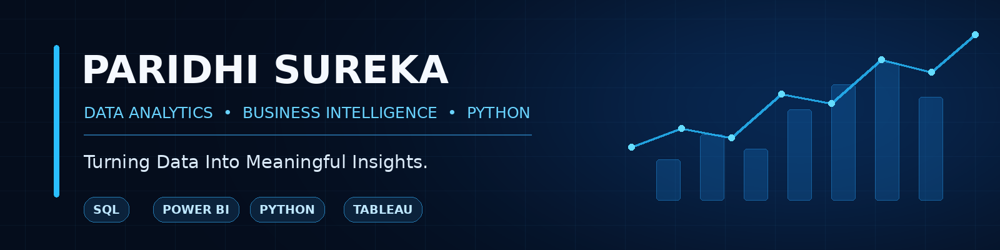

  

# Hi, I'm Paridhi Sureka 👋

### Data Analytics | Business Intelligence | SQL | Power BI | Python

I'm an MCA student with a commerce background, interested in using data, technology, and business understanding to solve real-world problems.

My background in accounts, financial reporting, business operations, and administration helps me approach data not just technically, but from a business perspective — understanding what the numbers mean and how they can support better decisions.

---

### 🧭 What I'm Focused On

- 📊 Data Analytics & Business Intelligence
- 🗄️ SQL & Database Management
- 📈 Data Visualization & Dashboard Development
- 🐍 Python for Data Analysis
- 💡 Turning business data into meaningful insights

---

### 🛠️ Tech Stack

#### Data Analytics & Business Intelligence

#### Programming & Development

#### Databases & Tools

---

### 🚀 Featured Projects

<table>
<tr>
<td width="100%">

#### 🧠 [NoteMind AI](https://github.com/Paridhi005/NoteMind-AI)

**AI-Powered Academic Knowledge Assistant**

An AI-powered study platform that transforms uploaded PDF notes into interactive learning resources.

- 📄 PDF uploads and notebook management
- 💬 Context-based AI question answering
- 📝 Automated summaries and quizzes
- 🎴 AI-generated flashcards

**Technologies**

[View Repository →](https://github.com/Paridhi005/NoteMind-AI)

</td>
</tr>
<tr>
<td width="100%">

#### 🤟 SilentSign

**Real-Time AI-Based Sign Language Interpreter**

An accessibility-focused application designed to support communication through gesture recognition and speech processing.

- Real-time gesture recognition
- Sign-to-text conversion
- Speech-to-text and text-to-speech
- AI-assisted communication

**Technologies:** React.js · Node.js · Express.js · MongoDB · AI

*Repository and documentation coming soon.*

</td>
</tr>
<tr>
<td width="100%">

#### 📊 Data Analytics Portfolio

**SQL | Python | Power BI | Tableau**

A growing collection of practical analytics projects focused on transforming raw data into meaningful business insights.

- SQL-based data exploration
- Python data analysis
- Business intelligence dashboards
- Data visualization and storytelling

🚧 Currently in development

</td>
</tr>
</table>

---

### 🎓 Education

**Master of Computer Applications (MCA)**  
Aditya Institute of Management, Technology and Research  
University of Mumbai | 2025–2027

**Bachelor of Commerce (B.Com) — Taxation & Computers**  
Bhavan's College, University of Mumbai  
CGPA: 9.47

---

### 📜 Certifications & Learning

- Microsoft Excel for Data Analyst — Infosys Springboard
- Tableau for Data Visualization — Infosys Springboard
- SQL for Data Analysis — Simplilearn
- SQL for Data Science — Simplilearn
- Learn Power BI Data Modeling with DAX — Simplilearn
- Python for Beginners — Simplilearn
- Python Libraries for Data Science — Simplilearn
- Software Development Job Simulation — Datacom

### 🌱 Currently Growing

Strengthening my analytical toolkit through hands-on projects, data exploration, Python, SQL, business intelligence, and data storytelling.

### 🤝 Let's Connect

[LinkedIn](https://www.linkedin.com/in/paridhi-sureka-19m05/)
  |  [Github](https://github.com/Paridhi005)

📍 Mumbai, India
